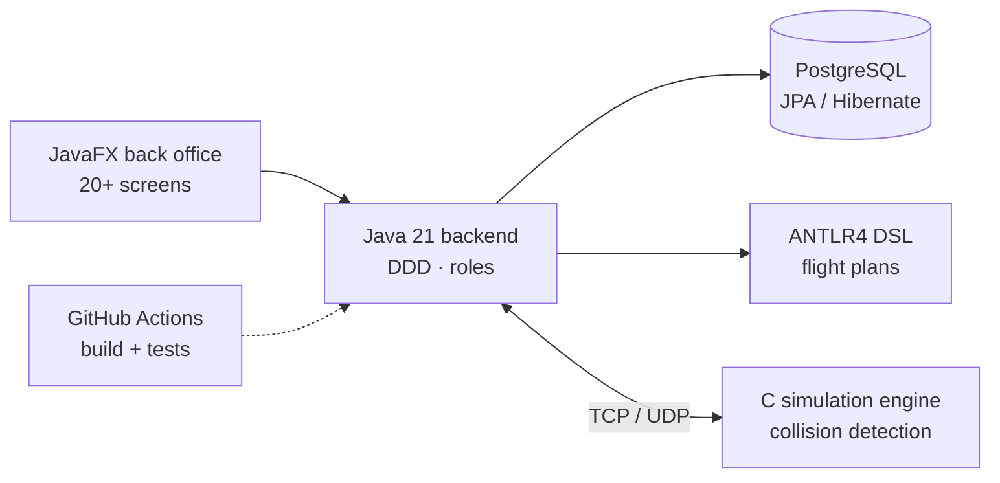
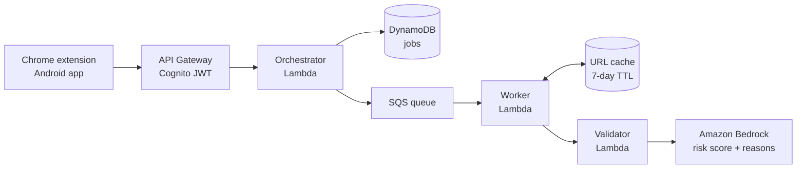
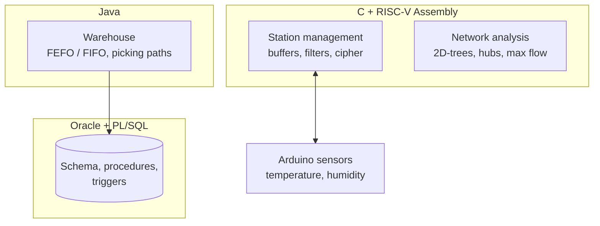

<div align="center">


<br>

[**portfolio**](https://portfolio-fabio-costa.netlify.app) &nbsp;·&nbsp; [**linkedin**](https://www.linkedin.com/in/f%C3%A1bio-rafael-costa-a791812b1/) &nbsp;·&nbsp; [**email**](mailto:fabiorcosta12@gmail.com)

</div>

<br>

I'm an Informatics Engineering student at ISEP, in Porto. I like knowing what happens under the hood, so I keep ending up in places like a C process talking over TCP, a RISC-V register, or a Lambda deciding if a link is safe. I'm curious about backend, security and AI, and I learn best by building the thing.

## `~/now`

```console
$ cat now.txt
building    LaPrizza, a pizza shop backend (products, stock, users, end-to-end tests)
tinkering   this profile and a new portfolio, in terminal style
following   backend, security and AI, in no particular order
```

## `~/projects`

| | Project | What it is | Built with |
|---|---|---|---|
| ✈️ | **[AISafe](https://github.com/1240826/aisafe-flight-control)** | Air traffic control back office with a custom flight-plan DSL and a C simulation engine. Team of 5, Scrum, CI/CD. | Java · JavaFX · ANTLR4 · C · TCP/UDP |
| 🛡️ | **[ProofPocket](https://github.com/1240826/proofpocket)** | Checks links, emails and messages for phishing before you open them. 46h hackathon. | TypeScript · React Native · AWS · Bedrock |
| 🚂 | **[Logistics on Rails](https://github.com/1240826/logistics-railway)** | Warehouse, freight and station management for railways, from SQL down to Assembly. | Java · PL/SQL · Oracle · C · RISC-V |
| 🎮 | **[Empire on Tracks](https://github.com/1240826/empire-on-tracks)** | Railway simulation game with a map editor. | Java · JavaFX · Python |
| 🧑 | **[Eigenfaces](https://github.com/1240826/eigenfaces-recognition)** | Face reconstruction and identification with PCA, no ML libraries. | Java · linear algebra |
| 🐉 | **[Dracomania](https://github.com/BlessedTeam1/The_Best_Game)** | 2D game made in an international Erasmus+ team. | Unity · C# |

<details>
<summary><code>man aisafe</code> &nbsp;·&nbsp; how it works</summary>

<br>

- **Backend (Java 21):** layered domain-driven design, JPA persistence, role-based access control and 20+ JavaFX screens for aircraft, flights, airports, weather and staff.
- **DSL (ANTLR4):** a language for describing flight plans, parsed and validated.
- **Simulation (C):** multi-process engine with collision detection, with POSIX shared memory and semaphores.
- **Remote access:** TCP/UDP between components.
- **Delivery:** GitHub Actions CI/CD, cross-platform Bash and batch scripts, 5-person Scrum team.



</details>

<details>
<summary><code>man proofpocket</code> &nbsp;·&nbsp; how it works</summary>

<br>

1. You submit a link, email or message from the **Chrome extension** or the **Android app** (these two were my part).
2. API Gateway authenticates with Cognito, then an orchestrator Lambda creates a job in DynamoDB and queues it in SQS.
3. A worker checks a 7-day cache; on a miss, a validator Lambda asks Amazon Bedrock for a risk score, a decision (`allow` / `review` / `block`) and the reasons.
4. The extension blocks the link before it opens and shows why.



</details>

<details>
<summary><code>man logistics-railway</code> &nbsp;·&nbsp; how it works</summary>

<br>

- **Warehouse (Java):** FEFO/FIFO order allocation and shortest picking paths.
- **Database (PL/SQL, Oracle):** schema, stored procedures and triggers for freight scheduling.
- **Network (C):** 2D-trees, Haversine distance, hub centrality and max flow on a railway graph.
- **Low level (RISC-V Assembly):** circular buffer, moving median filter and Caesar cipher, wired to Arduino sensors.



</details>

## `~/stack`


## `~/recent`

<!-- RECENT:START -->
```console
$ git log --oneline --all --author=fabio -n 6
41b698a  2026-07-11  empire-on-tracks       Fix formatting in README.md for MVC section
bfc83cf  2026-07-11  logistics-railway      Fix formatting in README architecture section
13f253b  2026-07-11  aisafe-flight-control  Update readme.md
4accc0d  2026-07-11  aisafe-flight-control  Fix table alignment in readme.md
9afad37  2026-07-11  aisafe-flight-control  Update architecture diagram in README
511baaf  2026-07-11  aisafe-flight-control  Update architecture diagram in README
```
<!-- RECENT:END -->

## `~/activity`

<picture>
  <source media="(prefers-color-scheme: dark)" srcset="https://raw.githubusercontent.com/1240826/1240826/output/snake-dark.svg">
  
</picture>

## `~/contact`

```console
$ mail fabio
portfolio  https://portfolio-fabio-costa.netlify.app
linkedin   https://www.linkedin.com/in/f%C3%A1bio-rafael-costa-a791812b1/
email      fabiorcosta12@gmail.com
```

<div align="center">


</div>
