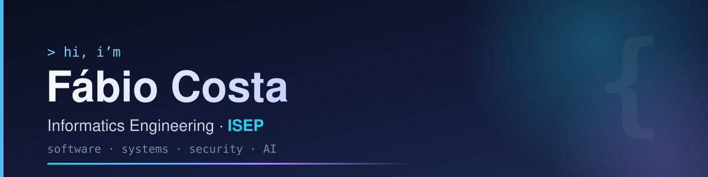

<div align="center">



**Informatics Engineering student at ISEP, Porto.**
I like knowing what happens under the hood, and turning hard problems into software that works.

[Portfolio](https://portfolio-fabio-costa.netlify.app) · [LinkedIn](https://www.linkedin.com/in/f%C3%A1bio-rafael-costa-a791812b1/) · [Email](mailto:fabiorcosta12@gmail.com)

</div>

---

```console
fabio@porto:~$ whoami
fabio-costa — informatics engineering, 3rd year @ ISEP

fabio@porto:~$ ls interests/
backend/  systems/  security/  ai/  football/

fabio@porto:~$ cat motto
learn the thing properly, then build it properly.
```

## 💻 Languages


## 🛠️ Tools & Technologies


## 🚀 Featured Projects

| Project | What it is | Built with |
|---|---|---|
| **[AISafe](https://github.com/1240826/aisafe-flight-control)** | Air traffic control back office with a custom flight-plan DSL and a C simulation engine. Team of 5, Scrum, CI/CD. | Java · JavaFX · ANTLR4 · C · TCP/UDP · GitHub Actions |
| **[ProofPocket](https://github.com/1240826/proofpocket)** | Checks links, emails and messages for phishing before you open them. Built in a 46h hackathon. | TypeScript · React Native · AWS Lambda · Bedrock |
| **[Logistics on Rails](https://github.com/1240826/logistics-railway)** | Warehouse, freight and station management for railways, from SQL down to Assembly. | Java · PL/SQL · Oracle · C · RISC-V |
| **[Empire on Tracks](https://github.com/1240826/empire-on-tracks)** | Railway simulation game with a map editor. | Java · JavaFX · Python |
| **[Eigenfaces](https://github.com/1240826/eigenfaces-recognition)** | Face reconstruction and identification with PCA, no ML libraries. | Java · linear algebra |
| **[Dracomania](https://github.com/BlessedTeam1/The_Best_Game)** | 2D game made in an international Erasmus+ team. | Unity · C# |

## 🎯 Skills

- **Software Development** → OOP, Design Patterns, MVC, Domain-Driven Design
- **DevOps & Automation** → CI/CD (GitHub Actions), cross-platform scripting (Bash / Windows batch), Linux & Windows
- **Systems Programming** → Multi-process and multi-threaded C, POSIX (shared memory, semaphores), TCP/UDP
- **Cloud** → AWS serverless (Lambda, DynamoDB, Bedrock)
- **Project Management** → Agile, Scrum, team collaboration
- **Problem Solving** → Algorithms, data structures, optimization
- **Languages** → Portuguese (native), English (Cambridge B2), French (basic)

## 📈 Contribution Activity

<picture>
  <source media="(prefers-color-scheme: dark)" srcset="https://raw.githubusercontent.com/1240826/1240826/output/snake-dark.svg">
  
</picture>

---

<div align="center">

📧 fabiorcosta12@gmail.com · 🌐 [portfolio-fabio-costa.netlify.app](https://portfolio-fabio-costa.netlify.app)

</div>
