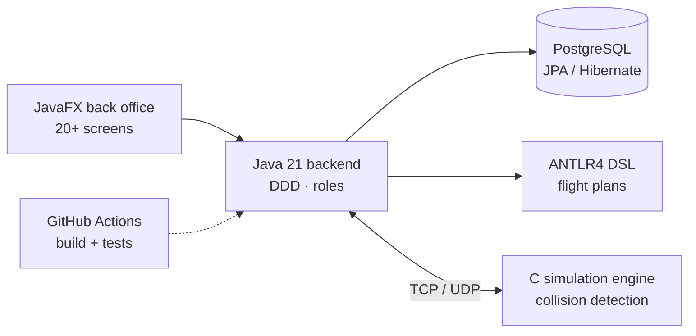
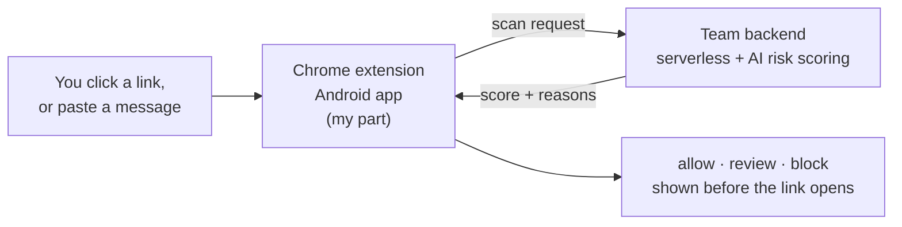
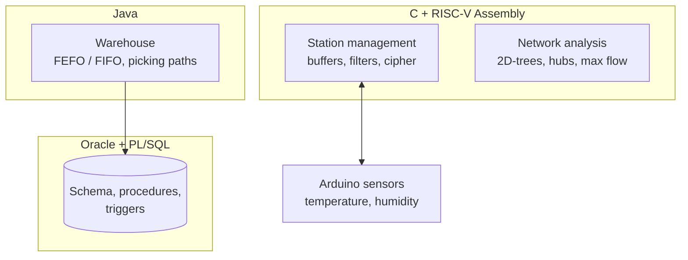

 

[**portfolio**](https://portfolio-fabio-costa.netlify.app) &nbsp;·&nbsp; [**linkedin**](https://www.linkedin.com/in/fabio-rb-costa/) &nbsp;·&nbsp; [**email**](mailto:fabiorcosta12@gmail.com)

 

Computer Engineering student at ISEP, in Porto. I'm most at home in backend and systems work, and increasingly drawn to security and AI. I like understanding why something works, not just getting it to run, and I learn best by building, ideally in a team.

## `~/now`

## `~/projects`

<b>✈️ AISafe</b> &nbsp;—&nbsp; air traffic control back office with its own flight-plan language

 

`Java 21` `JavaFX` `JPA / Hibernate` `PostgreSQL` `ANTLR4` `C` `TCP / UDP` `GitHub Actions`

Team of 5, Scrum, 4th-semester integrative project at ISEP.

- **Back office (Java):** layered domain-driven design, role-based access control and 20+ JavaFX screens for aircraft, flights, airports, weather and staff.
- **Flight-plan DSL (ANTLR4):** a small language for describing flight plans.
- **Simulation (C):** flight engine with collision detection, with remote access over TCP/UDP.
- **Delivery:** GitHub Actions CI/CD, cross-platform Bash and batch scripts.

**[→ repository](https://github.com/1240826/aisafe-flight-control)**

<b>🛡️ ProofPocket</b> &nbsp;—&nbsp; checks links, emails and messages for phishing before you open them

 

`TypeScript` `React` `React Native` `Chrome Extension (MV3)`

Built in 46 hours at the CodeSpring 2026 hackathon (team DevUnleashed).

- **My part:** the Chrome extension, which intercepts a link before it opens, and the Android app. Both talk to the team's backend.
- **Backend (team):** serverless on AWS with a generative AI model that returns a risk score, a decision (`allow` / `review` / `block`) and the reasons. I integrated with it but did not build it.

**[→ repository](https://github.com/1240826/proofpocket)**

<b>🚂 Logistics on Rails</b> &nbsp;—&nbsp; warehouse, freight and station management for railways

 

`Java` `PL/SQL` `Oracle` `C` `RISC-V Assembly` `Arduino`

Team project, 3rd-semester integrative project at ISEP.

- **Warehouse (Java):** FEFO/FIFO order allocation and shortest picking paths.
- **Database (PL/SQL, Oracle):** schema, stored procedures and triggers for freight scheduling.
- **Network (C):** 2D-trees, Haversine distance, hub centrality and max flow on a railway graph.
- **Low level (RISC-V Assembly):** circular buffer, moving median filter and Caesar cipher, connected to Arduino sensors.

**[→ repository](https://github.com/1240826/logistics-railway)**

<b>🎮 Empire on Tracks</b> &nbsp;—&nbsp; railway simulation game with a map editor

 

`Java` `JavaFX` `Python` `JUnit`

2nd-semester integrative project, inspired by Railroad Tycoon 2. Two modes: a map editor (cities, industries, stations, tracks) and a simulation where you run a railway company and move cargo. MVC and design patterns, with a Python module for statistics.

**[→ repository](https://github.com/1240826/empire-on-tracks)**

<b>🧑 Eigenfaces</b> &nbsp;—&nbsp; face reconstruction and identification, no ML libraries

 

`Java` `Linear algebra`

PCA implemented from scratch: mean face, covariance matrix, eigenvectors by power iteration, then reconstruction, identification and generation of faces. All matrix maths in pure Java.

**[→ repository](https://github.com/1240826/eigenfaces-recognition)**

<b>🐉 Dracomania</b> &nbsp;—&nbsp; 2D game made in an international team

 

`Unity` `C#`

Built during the Erasmus+ programme at Politehnica University of Timisoara, in a team from several countries.

**[→ repository](https://github.com/BlessedTeam1/The_Best_Game)**

## `~/stack`

<picture>
  <source media="(prefers-color-scheme: light)" srcset="https://skillicons.dev/icons?i=java,c,py,ts,js,cs,html,css&theme=light">
  
</picture>

<picture>
  <source media="(prefers-color-scheme: light)" srcset="https://skillicons.dev/icons?i=git,github,githubactions,linux,bash,postgres,react,unity,arduino&theme=light">
  
</picture>

Also: SQL · PL/SQL · Oracle · JavaFX · ANTLR4 · RISC-V Assembly · React Native

## `~/background`

- 🎓 **BSc in Computer Engineering**, ISEP (2024 – 2027)
- 🌍 **Erasmus+ programme**, Politehnica University of Timisoara (Jul – Aug 2025)
- 🏁 **Hackathons:** CodeSpring 2026 at ISEP (46h), Code Forward by Blip (2025)
- 🤝 **NEI-ISEP**, events team (2025 – 2026) · volunteer at SIMCONF 2025
- 📄 **Co-author** of a paper on teaching Taylor/Maclaurin series, SEI'24 symposium
- 🗣️ Portuguese (native) · English (B2) · French (basic)

## `~/activity`

<picture>
  <source media="(prefers-color-scheme: dark)" srcset="https://raw.githubusercontent.com/1240826/1240826/output/snake-dark.svg">
  
</picture>
